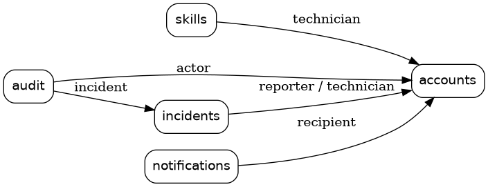

# OOPS_PROJECT
## Run the database-backed console

Install JDK 17 or later and Python 3.8 or later. Run these commands **from the project root** (the directory containing `src` and `database`).

**Windows PowerShell**
```powershell
javac -d out (Get-ChildItem -Recurse src -Filter *.java).FullName
java -cp out itsm.Main
```

**Linux/macOS**
```sh
javac -d out $(find src -name '*.java')
java -Ditsm.python=python3 -cp out itsm.Main
```

The first launch creates `itsm.sqlite` and four demo accounts. Use employee/emp123, admin/admin123, or tech1/tech123 to follow a ticket through the menus. Each successful change commits immediately. Restart from the same directory to continue. Set the Java system property `itsm.db` to select another file, or `itsm.python` to select a Python executable.

## Database design

SQLite provides transactions and foreign keys in a portable file. The existing Java classes still handle authorization, prioritization, assignment and status transitions. The small Python standard-library adapter in `database/store.py` handles storage without installing a database server or a JDBC driver. The console loads its working set on startup and saves a transactional snapshot after each write. This suits a small classroom dataset. If two consoles edit the same version, the second writer is stopped and must restart before retrying.



The accounts table stores the three user roles, department, availability and salted password hashes. Skills are separate rows per technician. Each incident has one reporter and an optional assigned technician. Its response and resolution deadlines are stored when created, along with lifecycle timestamps and resolution notes. Audit records link an actor to an incident. In-app notifications belong to recipients. The existing Java SLA rules supply policy durations. The uploaded application models the affected area using category and business criticality and has no separate service catalog.

Open `database/sample.sqlite` in a SQLite viewer for a completed gateway incident, seven audit entries and its notifications. To explore it through the console, copy it to another filename and pass that path with `-Ditsm.db=...` before `-cp`. The default database starts fresh.
